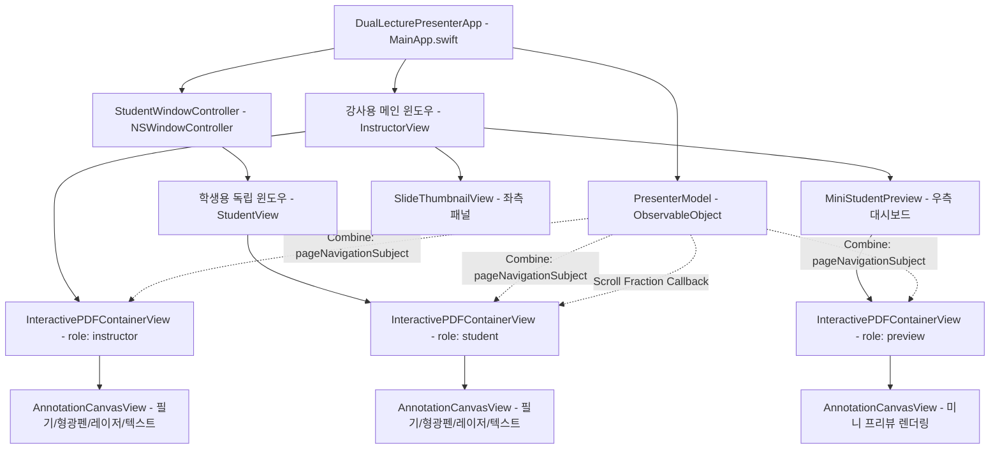

# 🧠 쌤쌤이 (SSamSSami) - 에이전트 메모리 (Agent Memory & Knowledge Base)

> **프로젝트 공식 문서**: 이 문서는 AI 에이전트 및 개발자를 위한 아키텍처 다이어그램, 핵심 동기화 메커니즘, 좌표계 수식, 트러블슈팅 지식(Lessons Learned), 빌드/릴리즈 파이프라인 명세를 집대성한 프로젝트 지속 기억(Memory) 문서입니다.

---

## 1. 프로젝트 정체성 및 핵심 목적 (Identity & Core Purpose)

- **공식 명칭**: **쌤쌤이 (SSamSSami)**
- **영문 부제**: A native macOS dual-PDF lecture presenter designed for teachers ("SSam") where both screens stay strictly synchronized ("Same-Same").
- **저장소**: [https://github.com/jaewookahn/DualLecturePresenter](https://github.com/jaewookahn/DualLecturePresenter)
- **핵심 목표**:
  1. **강사용(어노테이션, 비밀 메모, 답안 포함) PDF**와 **학생용(클린 버전) PDF**를 동시에 관리.
  2. 강사의 스크롤, 페이지 전환, 레이저 포인터, 필기, 형광펜, 텍스트 메모를 학생 화면에 **실시간 1:1 동기화**.
  3. 화상회의(Zoom, Google Meet, Teams)에서 **학생용 화면만 독립 윈도우(`NSWindow`)로 단독 공유**.
  4. 학생 화면은 그대로 둔 채 강사만 다음 장이나 답안을 미리 확인하는 **비밀 엿보기(Secret Peek)** 및 **학생 화면 암전(Blackout)** 지원.

---

## 2. 시스템 아키텍처 및 데이터 흐름 (Architecture)

### 2.1 클래스 및 뷰 계층 구조



### 2.2 기술 스택 및 라이브러리
- **언어**: Swift 6.1 (Strict Concurrency 완벽 대응, `@MainActor` 격리)
- **UI 아키텍처**: SwiftUI + AppKit 하이브리드
  - 윈도우 라이프사이클 및 화면 좌표 제어: `NSWindowController`, `NSWindow`
  - 고성능 문서 렌더링: Apple PDFKit (`PDFView`, `PDFDocument`, `PDFDestination`, `PDFClipView`)
  - 반응형 대시보드 및 도구 툴바: SwiftUI
- **이벤트 버스**: Combine (`PassthroughSubject<Int, Never>`)
- **키보드 이벤트**: AppKit 레벨 로컬 모니터 (`NSEvent.addLocalMonitorForEvents`)

---

## 3. 핵심 좌표계 및 동기화 수학 모델 (Mathematical Models)

### 3.1 AppKit PDFView 좌표계 및 연속 스크롤 비율 (Scroll Fraction)
AppKit의 `PDFView`는 전통적인 macOS 좌표계(`isFlipped == false`)를 따릅니다.
- **문서 맨 위(Top)**: `origin.y = maxScrollY`
- **문서 맨 아래(Bottom)**: `origin.y = 0`
- **총 스크롤 가능 높이**:
  $$\text{maxScrollY} = \max(\text{docView.frame.height} - \text{scrollView.contentView.bounds.height},\, 1.0)$$
- **비례 스크롤 비율 (Fraction)**:
  $$\text{fraction} = \text{clamp}\left(\frac{\text{currentY}}{\text{maxScrollY}},\, 0.0,\, 1.0\right)$$
- **학생 화면 복원**:
  $$\text{targetY} = \text{fraction} \times \text{studentMaxScrollY}$$
  $$\text{scrollView.contentView.scroll}(\text{NSPoint}(x, \text{targetY}))$$

### 3.2 정규화 페이지 좌표계 (Normalized Page Coordinates)
강사용 창과 학생용 창은 창 크기, 해상도, 디스플레이 배율이 서로 다릅니다. 따라서 마우스 좌표나 필기 좌표를 절대 픽셀로 전달하면 위치가 어긋납니다.
1. **뷰 좌표 ➔ PDF 페이지 좌표 변환**:
   $$\text{pdfPoint} = \text{pdfView.convert}(\text{viewPoint}, \text{to: page})$$
2. **정규화 좌표 산출 (0.0 ~ 1.0)**:
   $$\text{normX} = \frac{\text{pdfPoint.x}}{\text{page.bounds.width}}, \quad \text{normY} = \frac{\text{pdfPoint.y}}{\text{page.bounds.height}}$$
3. **학생 화면에서 뷰 좌표로 복원**:
   $$\text{studentPdfPoint} = (\text{normX} \times \text{studentPage.bounds.width},\, \text{normY} \times \text{studentPage.bounds.height})$$
   $$\text{studentViewPoint} = \text{studentPdfView.convert}(\text{studentPdfPoint}, \text{from: studentPage})$$

---

## 4. 해결된 핵심 기술 난제 및 지식 베이스 (Lessons Learned)

### 💡 레슨 1: AppKit PDFView의 키보드 이벤트(방향키, 스페이스바) 삼킴 현상
- **문제**: `PDFView`가 포커스를 얻으면 내부 `NSScrollView`/`PDFClipView`가 First Responder가 되어 방향키와 스페이스바를 자체 스크롤용으로 소비(`keyDown` 흡수)하여 SwiftUI `.keyboardShortcut`이 무반응함.
- **해결책**:
  `PresenterModel.setupKeyboardMonitor()`에서 `NSEvent.addLocalMonitorForEvents(matching: .keyDown)`를 등록.
  단, 인라인 텍스트 필드(`NSTextView`, `NSTextField`) 입력 중에는 타이핑을 방해하지 않도록 원본 이벤트를 그대로 통과시키고, 그 외에는 가로채어 `model.nextPage()` / `model.previousPage()`를 직접 실행하고 `nil`을 반환하여 소비.

### 💡 레슨 2: macOS 하드웨어 키보드 플래그 오판 버그
- **문제**: Mac 물리 키보드의 방향키(`←`, `→`, `↑`, `↓`)와 발표 리모컨 클릭커(`PageUp`, `PageDown`)는 macOS 하드웨어/OS 수준에서 자동으로 `.numericPad` 및 `.function` 플래그가 붙어 들어옴.
- **실패한 접근**: `event.modifierFlags.intersection(.deviceIndependentFlagsMask).isEmpty`로 검사하면 `.numericPad` 플래그 때문에 항상 `false`가 되어 물리 화살표 키가 무시됨.
- **올바른 해결책**:
  ```swift
  let userModifiers: NSEvent.ModifierFlags = [.command, .control, .option]
  if !event.modifierFlags.intersection(userModifiers).isEmpty {
      return event // 순수 단축키(⌘, ⌥, ⌃)만 통과
  }
  // 이제 하드웨어 플래그와 무관하게 화살표 키, 스페이스바가 100% 인식됨!
  ```

### 💡 레슨 3: SwiftUI 뷰 트리(DAG) 최적화와 명령형 네비게이션 충돌
- **문제**: `InstructorView`의 `GeometryReader` 내부에서 `model.currentPageIndex`를 명시적으로 읽지 않으면, 인덱스가 바뀌어도 SwiftUI가 `PDFKitRepresentedView`의 `updateNSView` 호출을 건너뜀 (좌측 썸네일 패널 테두리는 바뀌는데 메인 뷰는 안 넘어가는 증상 발생).
- **해결책**:
  SwiftUI의 비동기 선언형 렌더링에 페이지 전환을 맡기지 않고, **Combine `PassthroughSubject<Int, Never>` 기반의 직접 반응형 이벤트 버스**를 구축. `goToPage(index)` 호출 시 즉시 구독자(`InteractivePDFContainerView`)가 0ms 지연으로 `pdfView.go(to: targetPage)`를 직접 실행.

### 💡 레슨 4: 레이저 포인터/필기 도구 활성화 시 트랙패드 휠 스크롤 차단 문제
- **문제**: `AnnotationCanvasView`가 마우스 클릭을 받기 위해 `hitTest`에서 자신을 반환하면, 트랙패드 2손가락 스크롤 이벤트까지 차단되어 문서가 스크롤되지 않음.
- **해결책**:
  1. `.laser` 및 `.navigation` 도구일 때 `AnnotationCanvasView.hitTest()`는 `nil`을 반환 (레이저는 클릭 차단 없이 `NSTrackingArea`로 마우스 위치만 추적).
  2. `InteractivePDFContainerView.scrollWheel(with:)`를 오버라이드하여 `pdfView.scrollWheel(with: event)`로 무조건 포워딩.

### 💡 레슨 5: 창 화면 비율(Aspect Ratio) 일치 및 줌 레터박스 방지
- **문제**: 강사용 창과 학생용 창의 가로세로 비율이 다르면 Zoom 화면 공유 시 검은색 레터박스가 발생하거나, 연속 스크롤 시 화면 상하 가시 범위가 달라짐.
- **해결책**:
  `StudentWindowController.applyAspectRatio(_:)`에서 `NSWindow.contentAspectRatio` 제약 조건을 적용.
  - `.pdfNative`: PDF 1페이지 크기 기준 비율 고정
  - `.matchInstructor`: 강사용 PDF 뷰포트 크기 실시간 복제
  - `.ratio16_9` & `.ratio4_3`: 발표 표준 비율 원클릭 맞춤

### 💡 레슨 6: 앱 시작 시 키 윈도우 포커스 보존
- **문제**: 학생용 창을 띄울 때 `makeKeyAndOrderFront`를 호출하면 학생용 창이 키 포커스를 가져가서 강사용 창이 비활성화됨.
- **해결책**:
  `window.orderFront(nil)`을 호출하여 학생용 창은 화면에 띄우되 키보드 포커스는 강사용 창에 그대로 유지.

---

## 5. 도구별 세부 구현 명세 (Tools Specifications)

| 도구명 | 단축키 | 구현 방식 | 비고 |
| :--- | :--- | :--- | :--- |
| **기본 포인터** | `⌘ + 0` | `hitTest` 통과, 일반 PDFView 기본 인터랙션 | 텍스트 선택 등 가능 |
| **레이저 포인터** | `L` / `⌘ + L` | `NSTrackingArea` 마우스 추적, 반경 8pt 네온 레드 + 4pt 화이트 코어 | 2손가락 스크롤 100% 작동 |
| **펜 필기** | `P` / `⌘ + D` | 마우스 드래그 좌표 정규화 수집, `NSBezierPath` 실시간 드로잉 | 색상/굵기 선택 가능 |
| **형광펜 (하일라이터)** | `H` / `⌘ + H` | 반투명 노란색(`alpha: 0.38`), 22pt 굵기, `.multiply` 블렌드 모드 | 글자 가림 없이 도표/텍스트 강조 |
| **텍스트 타이핑** | `T` / `⌘ + T` | 클릭 위치에 인라인 `NSTextField` 오픈, Enter 시 정규화 배지 고정 | 학생 화면에 동일 배지 실시간 동기화 |
| **지우개** | `E` / `⌘ + E` | 마우스 드래그 반경 24pt 내의 모든 스트로크 점 및 텍스트 충돌 검사 삭제 | 현재 페이지 전체 삭제(`⌘+K`) 지원 |

---

## 6. 빌드, 패키징 및 CI/CD 파이프라인

### 6.1 로컬 빌드 및 설치 스크립트
- **`./build_app.sh [version]`**:
  - `swift build -c release`로 바이너리 생성
  - `쌤쌤이.app` 번들 구성 (인라인 `Info.plist`, `AppIcon.icns`, 샘플 PDF 포함)
  - `codesign --force --deep --sign -`로 ad-hoc 코드사인 적용
- **`./install_to_applications.sh`**:
  - `/Applications/쌤쌤이.app`으로 1클릭 설치 및 기존 버전 정리 후 실행

### 6.2 GitHub Actions 자동 릴리즈 (`.github/workflows/release.yml`)
- **트리거**: `v*` 태그 푸시 (예: `git tag v0.1.0 && git push origin v0.1.0`) 또는 Actions 탭에서 수동 실행.
- **러너**: `macos-latest` (Apple Silicon arm64 러너)
- **산출물**:
  1. `SSamSSami-<version>-macOS.dmg`: `hdiutil create`로 생성한 고압축 디스크 이미지
  2. `SSamSSami-<version>-macOS.zip`: `ditto -c -k --keepParent`로 생성하여 macOS 번들 속성과 퍼미션을 온전히 보존한 압축 파일
- **릴리즈 배포**: `softprops/action-gh-release@v2`를 통해 상세 릴리즈 노트와 함께 바이너리 자동 게시.

---

## 7. 주요 파일 및 디렉토리 구조 요약

```text
DualLecturePresenter/
├── .github/
│   └── workflows/
│       └── release.yml          # GitHub Actions 자동 릴리즈 워크플로우
├── Sources/
│   ├── MainApp.swift             # 앱 진입점, 메뉴바 단축키, 앱 라이프사이클
│   ├── Models/
│   │   ├── PresenterModel.swift  # 중앙 상태 관리, 키보드 모니터, Combine 이벤트 버스
│   │   └── DrawingStroke.swift   # 필기 스트로크, 형광펜, 텍스트 어노테이션 모델
│   ├── Views/
│   │   ├── InstructorView.swift  # 강사용 메인 대시보드 (툴바, 뷰포트, 미니모니터, 설정)
│   │   ├── StudentView.swift     # 학생용 클린 프레젠테이션 화면
│   │   ├── MiniStudentPreview.swift # 강사 대시보드 내 실시간 학생 화면 미니 모니터
│   │   ├── SlideThumbnailView.swift # 좌측 슬라이드 썸네일 탐색 패널
│   │   └── PDFKitRepresentedView.swift # AppKit PDFView + 캔버스 오버레이 NSViewRepresentable
│   ├── WindowControllers/
│   │   └── StudentWindowController.swift # 독립 NSWindow 제어, 화면 비율 락, 디스플레이 자동 배치
│   └── Helpers/
│       └── SamplePDFGenerator.swift # 첫 실행용 강사용/학생용 고화질 샘플 PDF 생성기
├── AppIcon.icns                  # 화사한 macOS 스퀘어클 공식 앱 아이콘
├── Package.swift                 # Swift Package Manager 매니페스트
├── build_app.sh                  # Release 번들 빌드 스크립트
├── install_to_applications.sh    # /Applications 설치 스크립트
├── README.md                     # 한국어 공식 사용자 가이드
├── README_EN.md                  # 영문 공식 사용자 가이드
├── WORK_LOG.md                   # 상세 작업 기록 및 기술 보고서
└── MEMORY.md                     # [본 문서] 지속 에이전트 메모리 및 아키텍처 명세서
```
